# Occult House

A first-person haunted museum that runs in the browser. You are locked in an old house of cursed objects at night. Pass a trial in each of its six rooms to earn the six keys to the front door. Fail three times and the house keeps you.

Built for the Manycore Aholo Global 3D AI Hackathon (#Manycorehackathon).

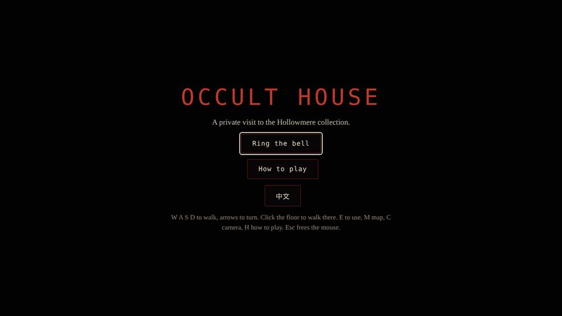

**Play it:** https://occult-house-nine.vercel.app · **Project report:** [Occult_House_Report.pdf](docs/Occult_House_Report.pdf) · **How the assets were made:** [docs/GENERATION.md](docs/GENERATION.md)

**Made by:** Helen ([@helenn-szn](https://github.com/helenn-szn))

## Screenshots

| | |
|---|---|
| 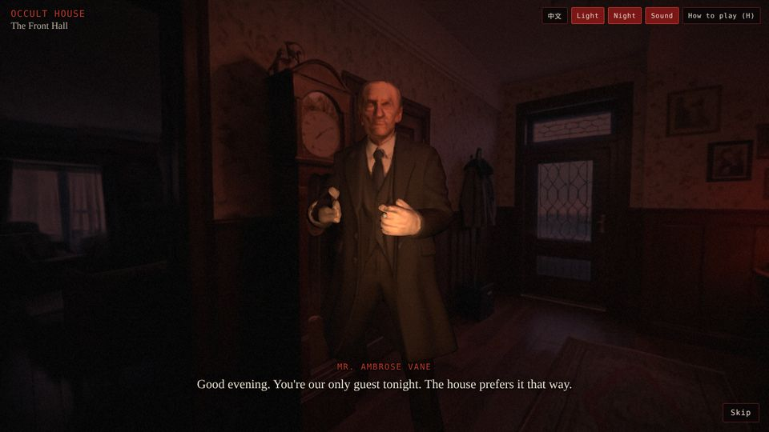 | 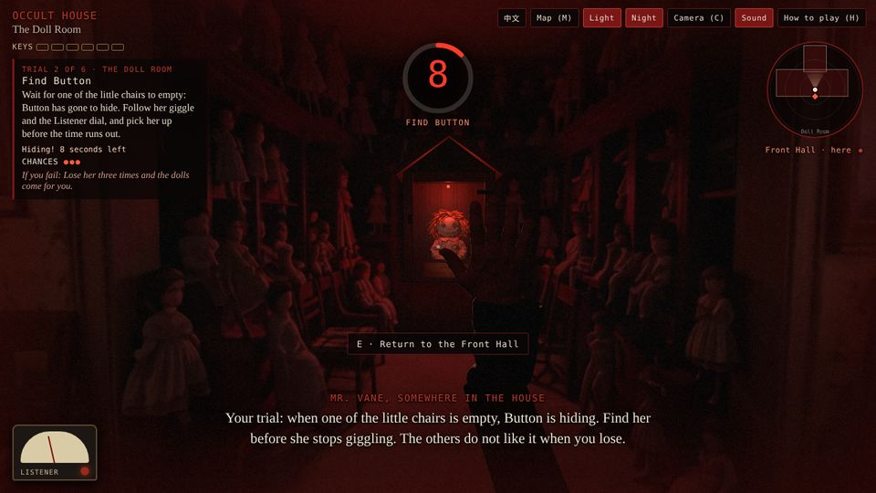 |
| Mr. Ambrose Vane, the curator, welcomes you in | The Doll Room: find Button before the countdown ends |
| 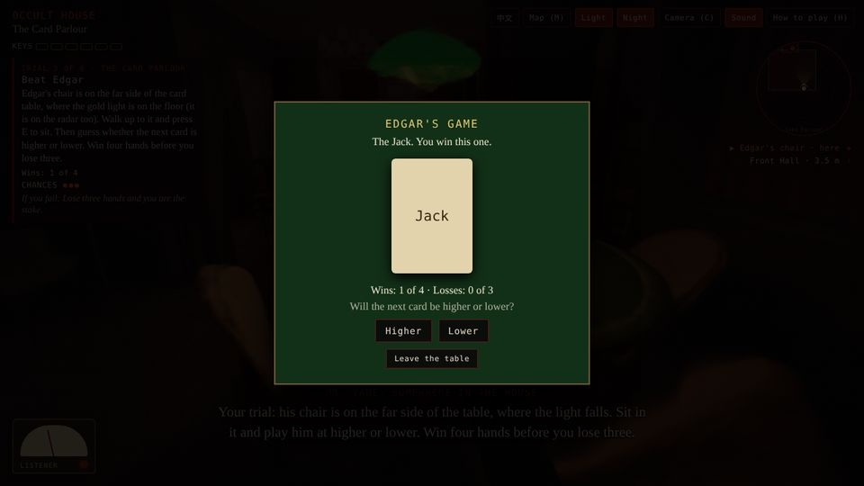 | 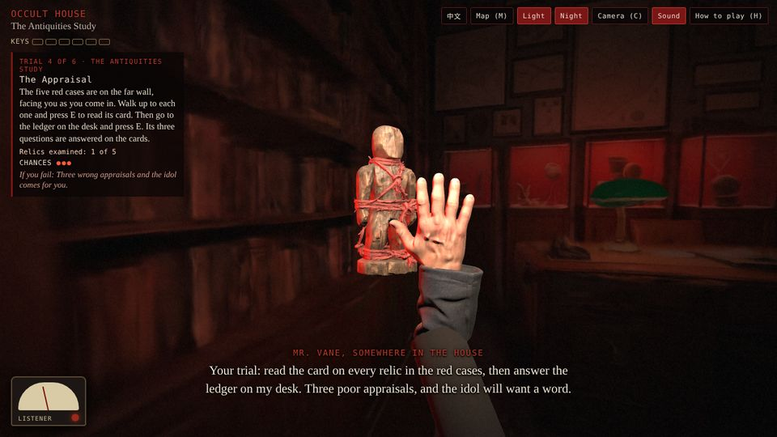 |
| The Card Parlour: beat Edgar at higher or lower | The Antiquities Study: examine the relics, then answer the ledger |
| 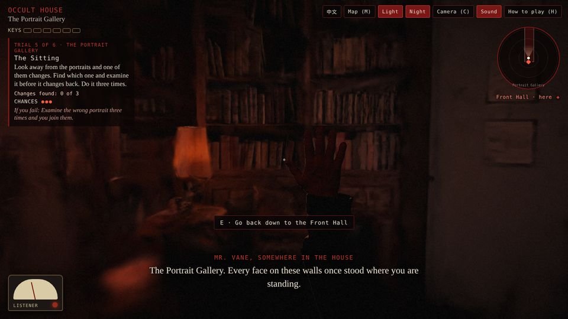 | 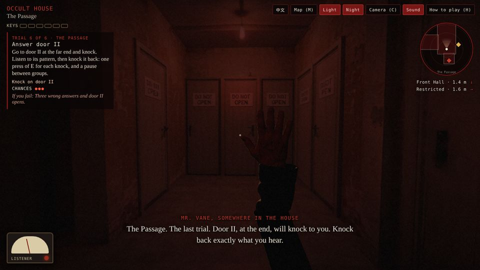 |
| The Portrait Gallery: catch the portrait that changed | The Passage: knock back what door II knocks |
| 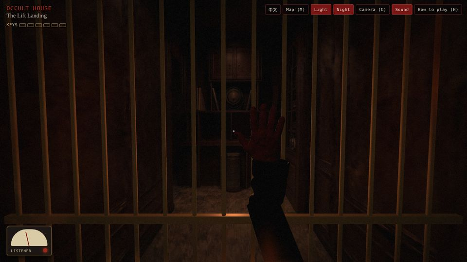 | 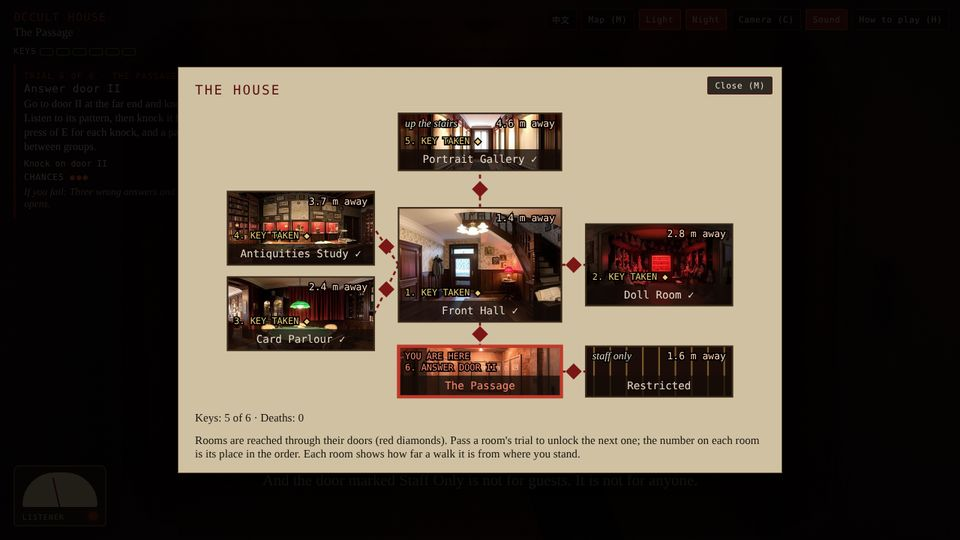 |
| Behind STAFF ONLY: the lift that only goes down | The map, with each room's Aholo panorama |
| 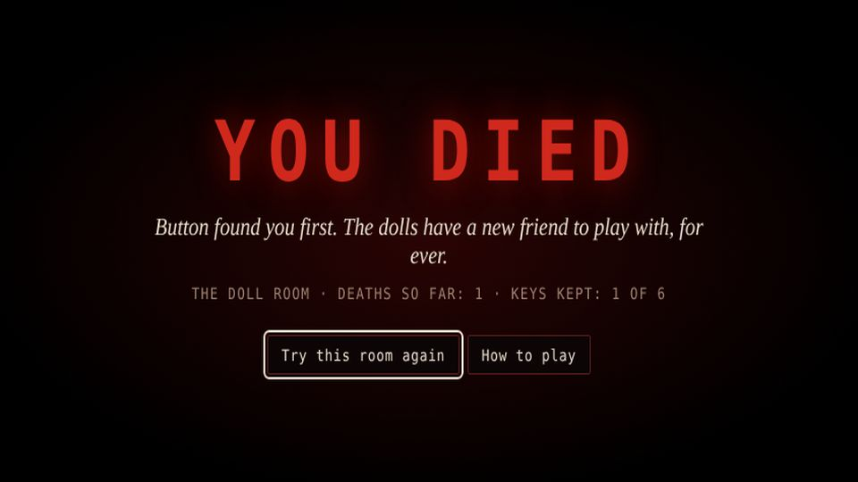 | 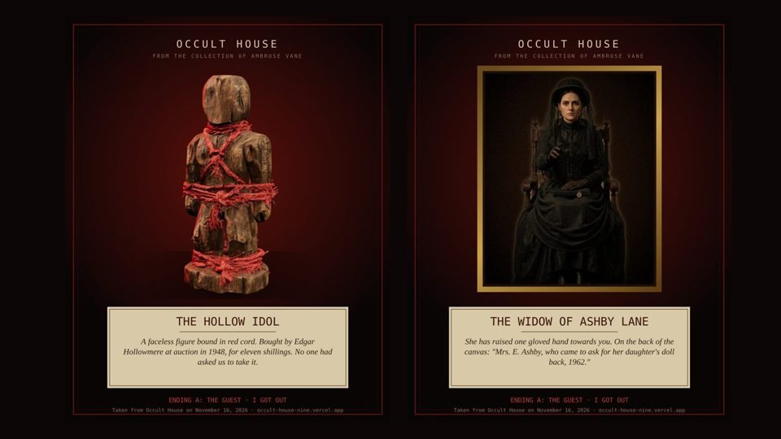 |
| Fail three times and you die, then retry that room | Escape and the house gives you a random keepsake |

## What's new here

- **You walk inside AI-generated worlds, not past them.** Every room is a full Aholo World API splat you can explore on foot, and the game logic, doors and trials are built around the space the world gave us.
- **Atmosphere added after generation.** Aholo lit the rooms for daytime, so the night, the red lamps, your own light and the light spilling under unlocked doors are all splat edits made live in the browser.
- **One rule, and the tool to break it in your pocket.** The camera shows you what the house hides, and every photo makes it worse. The game remembers, and it changes your ending.
- **AI assets as gameplay, not decoration.** The Lux3D relics hold the answers to the Study's ledger, the portraits change while you look away, and the rigged curator walks you through the house.
- **A reason to come back.** Escape and the house gives you one of 12 keepsakes, rendered live from the Lux3D models and portraits. It remembers what you took.
- **Plays anywhere.** No install and no account: mouse and keyboard, touch, or a game controller, in English or Chinese.

## How it fits together

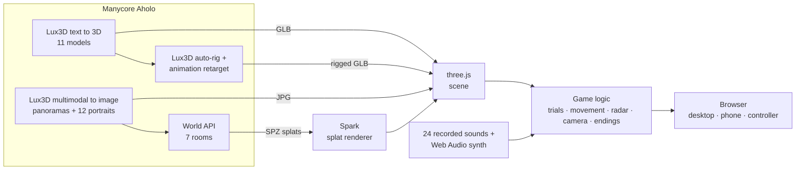

## Built with Manycore Aholo

| Part | Tool |
|---|---|
| The Front Hall | Aholo World API, generated from a 360° panorama made with Lux3D multimodal to image |
| The Doll Room | Aholo World API, generated from a text prompt and an edited 360° panorama |
| The Passage | Aholo World API, generated from a 360° panorama made with Lux3D multimodal to image |
| The Portrait Gallery | Aholo World API, generated from a 360° panorama made with Lux3D multimodal to image |
| The gallery's twelve portraits (each painting and its changed version) | Lux3D multimodal to image, then cropped, darkened and aged into oil paintings |
| The Antiquities Study | Aholo World API, generated from a 360° panorama made with Lux3D multimodal to image |
| The study's relics: the Brine Mirror, the Bell of St. Orrin, the Hollow Idol, Old Tom and the Ledger of Names | Lux3D text to 3D (G1) |
| The Card Parlour | Aholo World API, generated from a 360° panorama made with Lux3D multimodal to image |
| The Lift Landing (behind STAFF ONLY) | Aholo World API, generated from a 360° panorama |
| Panorama edits (lights off, midnight) | Lux3D multimodal to image |
| Marigold, the rag doll | Lux3D text to 3D (G1) |
| The player's hand | Lux3D text to 3D (G1) |
| The Vesper Deck, the spirit board and its pointer | Lux3D text to 3D (G1) |
| Mr. Ambrose Vane, the curator | Lux3D text to 3D (G1), humanoid auto-rig, and animation retarget (idle, talking, walk) |

Rendering uses [three.js](https://threejs.org) and [Spark](https://sparkjs.dev) for the Gaussian-splat rooms. The prompts, tools, timings and credits for every asset are in [docs/GENERATION.md](docs/GENERATION.md).

## How it plays

You are the only guest tonight, and the front door locks behind you. It has six locks. Every room holds a trial, and passing it earns a key and unlocks the next room. Fail a trial three times and you die. Bring all six keys back to the front door to leave.

- **How to play** is six short cards (swipe or Next) that open after the visitor agreement, before the curator's welcome, and again any time with H (Start on a controller). It covers the goal, every trial in order, what happens when you fail, how to find your way, the one rule and the controls.
- **The welcome**: the curator, Mr. Ambrose Vane, explains the six keys, the three chances and his one rule: no cameras.
- **The trial panel** in the top-left corner always says what to do next: the current trial, how to do it, your progress, your chances left (three red dots) and what happens if you fail. Between trials it tells you which room is next and how to get there.
- **The trials, in order**: each room's door stays locked until the trial before it is passed.

  | # | Room | Trial | Fail three times and... |
  |---|---|---|---|
  | 1 | Front Hall | Wind the clock: face it and hold E until it strikes | the spring tears loose and the clock strikes for you |
  | 2 | Doll Room | Find Button before her 60 seconds run out | the dolls come for you |
  | 3 | Card Parlour | Sit in Edgar's chair (marked by a gold light on the floor and on the radar) and beat him at higher or lower: win four hands before you lose three | you are the stake |
  | 4 | Antiquities Study | The Appraisal: examine five relics, then answer the ledger's three questions, drawn at random from 18 (all answered on the relic cards) | the idol comes out of its case |
  | 5 | Portrait Gallery | The Sitting: catch three portraits changing | you become a portrait by the door |
  | 6 | The Passage | Knock door II's pattern back | door II opens |

- **Dying**: the thing that follows you through the house comes for you, then a Game Over screen says how you died. Try again puts you back at the start of that room's trial with three fresh chances; keys you have already won stay yours.
- **Leaving**: with all six keys, unlock the front door. The curator sees you out. Two endings: The Guest (you never used the camera) and The Visitor (you did).
- **The one rule**: no cameras, but there is one in your pocket. Through its lens you see figures and writing on the walls. Every photo cracks the lens and brings them closer; on the eighth the figure comes through, you wake in the Front Hall with the curator standing over you, and from then on the figure follows you.
- **STAFF ONLY**: a door in the Passage that is never locked. Open it anyway and it locks behind you. On the Lift Landing, a real Aholo room, a brass cage lift waits. Step in, the gate runs shut, and the lift falls past every floor on the dial: TRAPPED. You try again from the Passage.
- **Light under the doors**: every unlocked door has warm light spilling under it, and the door to your next trial is the brightest. Locked doors stay dark. When a door unlocks, its light flickers on. STAFF ONLY shows a thin red line, and once you hold all six keys, daylight shows under the front door.
- **Easy to get around**: click or tap the floor to walk there (walks route around furniture), or click/tap a door in the radar list to walk to it. Arrow keys turn. On phones the joystick is bigger, with a dead zone and smoother movement. You no longer have to face things exactly to use them.
- **中文 / English**: a button on the title screen and in the top bar switches the whole game to Chinese, including the how-to-play cards, every trial, note and prompt, the map, radar, endings and keepsake. The curator speaks Chinese where the device has a Chinese voice. The choice is remembered.
- **A keepsake**: when you get out, the house gives you one artifact at random (a relic, Marigold or a portrait) as a framed picture to download or share. It remembers what you have taken and offers something new on your next visit, 12 in all.
- **Finding your way**: the radar in the top corner shows the room you are in (turned so you always face up), a diamond for every door, and a list of the doors, nearest first, with distances, arrows and which ones are still locked. The next trial's door is marked with ▶. The map (M) shows every room with a picture of it, its place in the order, whether it is locked, and whether its key is taken.
- **The rooms** are walkable Aholo splat rooms, darkened in code so only red light and your own light show the way. Marigold sits in her cabinet in the Doll Room and turns to face you when you look away; touch the cabinet and the house answers. The Card Parlour's Vesper Deck draws omens and its spirit board spells messages.

## Controls

- W A S D to walk, mouse to look (click to capture the mouse, Esc to release)
- E to interact (hold E when the prompt says hold), C to raise the camera (click or Space takes a photo), M for the map, H for How to play, Space or click to move the curator's welcome along, L to switch your light, N to switch night mode
- With a game controller: left stick to walk, right stick to look, A to use things (hold A for the clock), B to close, X to raise the camera, RT or RB to take a photo, Y or View for the map, Start for How to play, D-pad up and down for Edgar's game
- On a phone or tablet (best held sideways): a joystick appears under your left thumb to walk, drag on the right to look, tap to continue or take a photo, and on-screen buttons for using things, the camera and the map

Headphones recommended. The house ambience, whispers, door creaks, footsteps, thuds, knocks, scratching, the clock's bell, winding and spring, cards, creaking canvas, breaking glass, Button's giggle, the curator's keys, locked-door rattles, door II's pounding, the camera's shutter and glitch, the jump-scare stingers, the lift's gate and cable, the death scream and the Game Over sting are royalty-free recordings (in `assets/sfx/`); the rest of the sound is synthesised in the page, and any recording that fails to load falls back to its synthesised version.

## Testing

An automated playthrough ([`tests/playthrough.py`](tests/playthrough.py), Playwright) plays the whole game from the title screen: all six trials in order, a death and retry, the STAFF ONLY lift trap and the ending. It passes 48 of 48 checks: see the full log in [`tests/results/playthrough.log`](tests/results/playthrough.log). Two more runs ([`tests/phone_touch.py`](tests/phone_touch.py), [`tests/phone_ledger.py`](tests/phone_ledger.py)) play it as a phone in landscape with touch, the joystick and tap-to-walk. All runs use Chromium. How to run them: [`tests/README.md`](tests/README.md). The game needs a browser with WebGL 2.

## Run locally

It is a static site with no build step. Serve the folder with any web server, for example:

```
npx serve .
```

Then open the address it prints. Opening `index.html` directly from disk will not work, because the browser blocks loading the room and model files that way.

## Files

```
index.html            the game
assets/front_hall.spz the Front Hall (compressed Gaussian splats)
assets/doll_room.spz  the Doll Room (compressed Gaussian splats)
assets/passage.spz    the Passage (compressed Gaussian splats)
assets/parlour.spz    the Card Parlour (compressed Gaussian splats)
assets/study.spz      the Antiquities Study (compressed Gaussian splats)
assets/gallery.spz    the Portrait Gallery (compressed Gaussian splats)
assets/lift.spz       the Lift Landing, behind the STAFF ONLY door (compressed Gaussian splats)
assets/portrait_*.jpg the gallery's paintings, two versions of each
assets/map_*.jpg      the map's pictures of each room, cropped from the room panoramas
assets/sfx/*.mp3      recorded sounds (24): the house ambience and the lift's cable groan (seamless loops) and the game's effects
assets/marigold.glb   Marigold
assets/hand_right.glb the player's right hand
assets/curator.glb    the curator, rigged, with idle, talk and walk animations
assets/deck.glb       the Vesper Deck
assets/board.glb      the spirit board
assets/planchette.glb the board's pointer
assets/relic_*.glb    the study's relics, shown up close when examined
```

All characters, objects and names are invented.

## License

The code is released under the [MIT License](LICENSE). The generated rooms, models, portraits and the report are © 2026 Helen.
